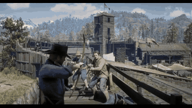
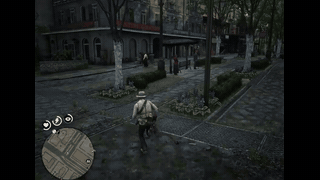
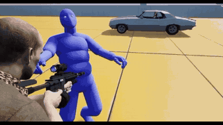

# PARS

**Procedural Active Ragdoll System**

애니메이션과 물리 시뮬레이션을 결합해 캐릭터의 움직임과 충돌 반응을 구현하는 프로젝트입니다.
캐릭터의 강체와 관절이 목표 애니메이션 자세를 추종하면서 외력과 주변 환경에 반응하도록 구성합니다.

Microsoft MiniEngine을 확장한 **C++ · DirectX 12 · PhysX 5.6.1 · Dear ImGui** 기반의 Windows x64 프로젝트입니다.

[주요 기능](#주요-기능) · [레퍼런스 영상](#레퍼런스-영상) · [발표자료](#발표자료) · [빠른 시작](#빠른-시작) · [개발 가이드](docs/DEVELOPMENT.md) · [참고 문헌](#참고-문헌)

## 주요 기능

| 기능 | 내용 |
| --- | --- |
| 액티브 래그돌 | 애니메이션·패시브 래그돌·액티브 래그돌 모드 전환과 물리 포즈 렌더링 |
| 물리 기반 자세 추종 | 관성·고유진동수 기반 PD 구동과 중력·코리올리/원심력·목표 가속도에 대한 추가 보상 |
| 캐릭터 조작과 충격 실험 | 걷기·달리기, 이동 애니메이션 블렌딩, 구 발사를 이용한 충격 반응 확인 |
| 물리 애셋 편집 | 강체와 관절, 트위스트·스윙 제한 및 드라이브 설정 편집·저장 |
| 동작 비교와 분석 | 키네마틱 기준 더미와 액티브 래그돌 비교, 바디·관절 오차 확인, HTML·CSV 보고서 |

개발 중인 프로젝트로, 균형 제어와 절차적 발 디딤의 설계·진행 내용은 [관련 문서](#관련-문서)에 정리합니다.

## 레퍼런스 영상

캐릭터의 피격 반응, 이동 중 충돌, 균형을 잃고 넘어지는 동작을 참고하는 외부 영상입니다.
아래 GIF는 짧은 미리보기이며, 이미지나 **영상 보기**를 누르면 원본 MP4 파일을 열 수 있습니다.

| RDR2 · 피격 반응 | RDR2 · 이동 중 충돌 | 유포리아 레퍼런스 · 충격 반응 |
| --- | --- | --- |
|  |  |  |
| [영상 보기](docs/media/RDR2레퍼런스동영상.mp4) · 약 11초 | [영상 보기](docs/media/RDR2레퍼런스동영상2.mp4) · 5초 | [영상 보기](docs/media/유포리아레퍼런스동영상%20.mp4) · 약 6초 |

## 발표자료

프로젝트의 목표, 기술적 접근과 주차별 진행 내용을 정리한 발표자료입니다.

| 1주차 | 2주차 | 3주차 |
| --- | --- | --- |
| [1주차 발표자료](https://www.canva.com/design/DAHYFBn98Zc/BCHxzDVSFVDVx0fE3fzTkA/edit) | [2주차 발표자료](https://canva.link/yow5q7gh7rrlmi0) | [3주차 발표자료](https://canva.link/fzt4crcfri8y5z5) |

## 빠른 시작

### 개발 환경

- Windows x64 및 DirectX 12를 지원하는 GPU·드라이버
- Visual Studio 2022 **17.14 이상**: **C++를 사용한 데스크톱 개발**, **MSVC v143**, **Windows SDK**
- **Windows용 C++ CMake 도구**(CMake 3.25 이상), **Git**

### 빌드 및 실행

1. 저장소를 복제하고 [`MiniEngine/ModelViewer/ModelViewer.slnx`](MiniEngine/ModelViewer/ModelViewer.slnx)를 엽니다.
2. **Debug / Windows**(x64)를 선택하고 **ModelViewer**를 시작 프로젝트로 설정합니다.
3. **F5**로 빌드하고 실행합니다. 기본 장면에서 물리 테스트와 캐릭터를 확인할 수 있습니다.

첫 빌드는 인터넷 연결이 필요하며, NuGet·vcpkg 의존성 복원과 PhysX 빌드 때문에 시간이 더 걸립니다.
`.slnx`를 열 수 없는 환경에서는 같은 폴더의 [`ModelViewer.sln`](MiniEngine/ModelViewer/ModelViewer.sln)을 사용합니다.

명령줄 빌드, 구성별 차이와 ARM64 안내는 [개발 가이드](docs/DEVELOPMENT.md#빌드)에 정리되어 있습니다.

## 기본 사용법

| 입력 | 동작 |
| --- | --- |
| **WASD** | 캐릭터 이동 |
| **Shift** | 달리기 |
| **마우스 오른쪽 버튼 유지** | 시점 회전·조준 |
| **조준 중 왼쪽 클릭** 또는 **R** | 충격 실험용 구 발사 |
| **Tab** | 캐릭터 조작 ↔ 자유 카메라 전환 |
| **WASD / Q·E** | 자유 카메라에서 수평 / 아래·위 이동 |
| **F1** | 물리 테스트 패널 표시 전환 |

**창 → 래그돌 비교**에서 **시뮬레이션 A 시작**(대기·걷기·달리기) 또는 **시뮬레이션 B 시작**(직진·유턴)을 누르면 두 더미를 비교할 수 있습니다.
**HTML 저장**으로 결과를 내보내고, 보고서에서 CSV 다운로드와 인쇄/PDF 저장을 할 수 있습니다.
상자 낙하 실험, 물리 애셋 편집과 세부 조작법은 [개발 가이드](docs/DEVELOPMENT.md#조작과-실험)를 참고하세요.

## 프로젝트 구조

| 경로 | 역할 |
| --- | --- |
| [`MiniEngine/Core`](MiniEngine/Core) | 렌더링 기반, 입력·카메라, 물리 월드, 게임 프레임워크 |
| [`MiniEngine/Model`](MiniEngine/Model) | 모델·애니메이션, 물리 애셋, 래그돌과 캐릭터 제어 |
| [`MiniEngine/ModelViewer`](MiniEngine/ModelViewer) | 실행 프로그램, 편집 UI, 비교·검증 도구 |
| [`MiniEngine/Tests`](MiniEngine/Tests) | 물리·캐릭터·컴포넌트 관련 테스트 |
| [`ThirdParty`](ThirdParty) | PhysX와 Dear ImGui 소스 |
| [`docs`](docs) | 개발 가이드, 설계·검토 기록, 레퍼런스 영상 |
| [`Tools`](Tools) · [`vcpkg`](vcpkg) | 개발 도구와 의존성 설정 |

`Samples`, `Libraries`, `TechniqueDemos`, `Assets`에는 기반 프로젝트의 예제·공용 코드·애셋을 보존합니다.

## 관련 문서

| 문서 | 내용 |
| --- | --- |
| [개발 및 실행 가이드](docs/DEVELOPMENT.md) | 빌드, 실행 옵션, 조작법, PVD 연결, 테스트 명령 |
| [PVD 설치 가이드](docs/PVD_SETUP.md) | 다른 PC에서 디버거 설치·연결 확인 |
| [COM 균형 제어](docs/COM_BALANCE_PLAN.md) | 질량중심과 지지 영역을 이용한 제어 설계 |
| [절차적 발 디딤](docs/PROCEDURAL_FOOTSTEP_PLAN.md) | 발 디딤 계획과 진행 기록 |
| [캐릭터 몸통 충돌](docs/CHARACTER_BODY_IMPACT_PLAN.md) | 캐릭터 간 충돌 처리 설계 |
| [PhysX 통합](ThirdParty/PhysX/README.PARS.md) · [ImGui 통합](ThirdParty/ImGui/README.PARS.md) | 포함 버전, 빌드와 사용 방법 |

## 참고 문헌

프로젝트의 제어식과 균형 제어 개념에 참고한 자료입니다.

1. **3중 추가 보상**

   Pradeep K. Khosla, Takeo Kanade (1988).
   [*Experimental Evaluation of Nonlinear Feedback and Feedforward Control Schemes for Manipulators*](https://publications.ri.cmu.edu/storage/publications/pub_files/pub3/khosla_pradeep_1988_1/khosla_pradeep_1988_1.pdf).
   *The International Journal of Robotics Research*, 7(1), 18–28.

   중력, 코리올리·원심력, 목표 가속도에 대한 관성 보상을 더하는 피드포워드 제어 구성의 참고 문헌입니다.

2. **관성·고유진동수 기반 PD 구동식**

   Kevin M. Lynch, Frank C. Park (2017).
   [*Modern Robotics: Mechanics, Planning, and Control*](https://modernrobotics.org/). Cambridge University Press.

   관성과 고유진동수·감쇠비의 관계를 이용한 PD 게인 산정의 참고 문헌입니다.
   관련 설명은 [11.4절 보충 강의: 토크·힘 입력을 이용한 운동 제어](https://modernrobotics.northwestern.edu/nu-gm-book-resource/11-4-motion-control-with-torque-or-force-inputs-part-1-of-3/)에서 확인할 수 있습니다.

3. **COM(질량중심) 기반 균형 제어 개념**

   Victor B. Zordan (2004).
   [*Controlling Reactive, Motion Capture-driven Simulated Characters*](https://media.gdcvault.com/gdc04/slides/motion_capture-driven_sim.pdf). GDC 2004.

   질량중심과 발이 만드는 지지 다각형을 이용한 캐릭터 균형 제어 개념의 참고 자료입니다.

## 라이선스 및 출처

이 프로젝트는 [MIT 라이선스](LICENSE)를 따릅니다.
기반 엔진인 MiniEngine은 Microsoft의 [DirectX-Graphics-Samples](https://github.com/microsoft/DirectX-Graphics-Samples)에서 가져왔으며, 원본 저작권과 라이선스 고지를 보존합니다.
외부 라이브러리, 샘플 애셋과 레퍼런스 영상의 권리는 각 권리자에게 있습니다. 포함된 라이브러리와 애셋은 각자의 라이선스를 따릅니다.
