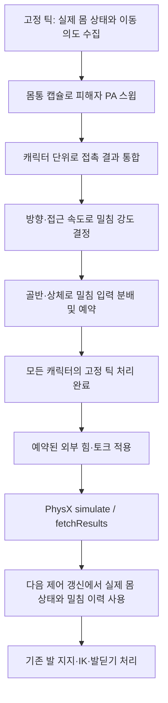

# 캡슐 기반 캐릭터 몸통 밀침 구현 계획

- 작성일: 2026-11-05
- 상태: 설계 및 작업 계획. 이 문서 작성으로 구현이나 수치 설정을 적용하지 않는다.
- 범위: 플레이어가 몸으로 NPC 또는 더미를 밀치는 상호작용. 구 발사 충돌과 구분한다.

## 1. 목표와 설계 방향

플레이어의 몸통에 맞춘 캡슐로 밀침을 판정하고, 피해자의 골반을 포함한 상체 PA 바디에 밀침 입력을 전달한다. 피해자의 실제 이동과 기울어짐은 Articulation이 계산하고, 기존 발 지지·다리 IK·발딛기 제어를 연결한다.

| 역할 | 담당 |
|---|---|
| 가해자의 밀침 판정 | 플레이어의 몸통 캡슐 쿼리 |
| 피해자 식별과 접촉 정보 | NPC/더미의 PA 바디, 소유 캐릭터, 접촉점과 법선 |
| 밀침 강도 결정 | PARS의 캐릭터 상호작용 로직 |
| 밀침 적용 대상 | 피해자의 골반과 선택한 상체 바디 |
| 신체의 물리적 반응 | PhysX Articulation |
| 하체의 목표 제어 | 기존 발 지지·서 있기 보정·IK·발딛기 |

이 설계는 충돌 판정에 쓰는 형상과 힘을 적용받는 물리 바디를 분리한다. 다른 게임의 내부 구현을 확정한 내용이 아니라 PARS에 적용할 설계안이다.

관절 PD 계산식과 토크 상한을 변경하는 작업은 이번 계획의 필수 범위에 포함하지 않는다. 사용자가 구현 후 직접 튜닝할 수 있도록 밀침 수치는 설정으로 분리하고 뷰어에 노출한다. 충격 배율, 충격량 상한, 상체 분배 비율 등의 초기 수치는 아직 정하지 않았다.

## 2. 현재 코드에서 확인한 사항

- `PhysicsQueryCapsule`은 쿼리 전용 형상이다. `PxActor`나 `PxShape`를 생성하지 않으며, 캡슐 쿼리 자체가 PhysX 접촉 충격량을 만들지는 않는다.
- `CharacterMovementComponent::FixedTickComponent()`는 이동 의도를 계산한 뒤 이동 제한과 캡슐 이동을 수행한다.
- ActiveRagdoll에서는 `Character`가 `SkeletalMeshComponent::ConstrainHorizontalMovement()`를 이동 제한 콜백으로 연결한다.
- `Ragdoll::ConstrainHorizontalMovement()`는 실제 PA 형상과 목표 PA 형상을 스윕한다. 다른 캐릭터의 동적 PA 바디도 차단 대상이 될 수 있다.
- 애니메이션용 이동 속도와 차단 결과를 반영한 이동 속도는 별도로 관리된다. 달리기 모션만으로 실제 충돌 속도를 판단하면 안 된다.
- 현재 더미는 이동과 이동 캡슐이 비활성화돼 있다. 이번 설계에서는 피해자 PA를 판정 대상으로 사용하므로, 더미에 이동 캡슐을 켜는 것이 필수는 아니다.
- `Ragdoll::AddVelocity()`는 Articulation 루트의 선속도를 직접 변경한다. 골반과 상체에 부위별 힘을 전달하는 인터페이스가 아니다.
- 회복 제어의 외부 충격 입력은 현재 PhysX 접촉 기록을 읽는다. 새 캡슐 밀침 이벤트는 별도로 연동해야 한다.

## 3. 목표 처리 흐름



- 밀침 판정에 필요한 정보는 기존 이동 차단으로 이동량이 줄어들기 전에 수집한다.
- 입력 속도, 이동 목표 속도, 실제 PA 바디의 속도를 구분해서 기록한다. 충돌 강도를 애니메이션 속도로 대체하지 않는다.
- 힘 적용은 캐릭터 순회가 끝난 뒤 `simulate()` 전에 모아서 처리한다. 가해자와 피해자 중 누가 먼저 고정 틱을 실행했는지에 따라 결과가 달라지지 않게 한다.
- 판정용 캡슐은 실제 물리 몸의 위치를 기준으로 맞춘다. 입력으로 움직이는 목표 위치와 실제 몸 사이에 오차가 있어도 판정 형상이 몸보다 앞서가지 않도록 한다.

## 4. 교체·추가할 위치

| 위치 | 해야 할 일 |
|---|---|
| [CharacterMovementComponent.h / .cpp](../MiniEngine/Core/GameFramework/CharacterMovementComponent.cpp) | 이동 방향·속도·요청 이동 구간을 밀침 판정 경로에 전달할 연결점을 추가한다. Core 이동 코드가 PARS의 구체적인 밀침 계산에 직접 의존하지 않게 한다. |
| [Character.cpp](../MiniEngine/Model/GameFramework/Character.cpp) | 플레이어의 캡슐·이동·메시와 밀침 처리를 연결한다. 기존 수평 이동 제한 콜백과 새 밀침 경로의 역할을 구분한다. |
| [PhysicsWorld.h / .cpp](../MiniEngine/Core/PhysicsWorld.cpp) | 밀침용 캡슐 쿼리를 추가한다. 상대 Actor/바디, 소유자, 접촉 위치, 법선, 거리 등 필요한 정보를 반환한다. 이동 쿼리의 벽·바닥 플래그만으로 처리하지 않는다. |
| `MiniEngine/Model/Components/CharacterImpactComponent.h / .cpp` 등 신규 PARS 컴포넌트 | 새 클래스 이름과 위치는 구현 시 확정한다. 접촉 통합, 밀침 강도 계산, 재발동 조건, 골반·상체 분배 및 밀침 이력을 담당한다. |
| [Ragdoll.cpp의 MovementQueryFilter / ConstrainHorizontalMovement](../MiniEngine/Model/Ragdoll.cpp) | 벽·정적 환경 차단과 밀 수 있는 캐릭터에 대한 처리를 분리한다. 기존 스윕이 밀침 판정 전에 접근을 차단하거나 두 정책이 충돌하지 않도록 한다. |
| [Ragdoll.h / .cpp](../MiniEngine/Model/Ragdoll.h) | 지정된 골반·상체 바디에 외부 힘과 필요한 회전 효과를 전달하는 수신 인터페이스를 추가한다. 기존 `AddVelocity()`로 대체하지 않는다. |
| [PhysicsWorld.cpp의 ContactFilter](../MiniEngine/Core/PhysicsWorld.cpp) 및 캐릭터 PA 필터 설정 | 새 밀침과 기존 PA↔PA 접촉 반응의 중복을 관리할 필터 정책을 추가한다. 캐릭터 간 상호작용과 바닥·주변 물체·발사체 충돌을 구분한다. |
| [World.cpp의 고정 스텝 처리](../MiniEngine/Core/GameFramework/World.cpp) | 모든 `Actor::FixedTick()` 이후, PhysX 시뮬레이션 이전에 예약된 밀침을 적용할 연결점을 마련한다. Core가 Model의 `Ragdoll`을 직접 참조하지 않도록 범용 훅 또는 큐 인터페이스를 검토한다. |
| [SkeletalMeshComponent 및 SkeletalMeshRecovery.cpp](../MiniEngine/Model/Components/SkeletalMeshRecovery.cpp) | 새 밀침 이력을 기존 충격·회복 입력과 연결한다. 실제 접촉 충격과 새 밀침을 중복 집계하지 않고, 동일 스텝을 반복 처리하지 않게 한다. |
| Model 프로젝트 파일 및 관련 테스트 | 신규 소스를 프로젝트에 등록하고, 캡슐 판정·필터·중복 방지와 실제 캐릭터 몸통 충돌 검증을 추가한다. |

`RagdollImpactTest`는 현재 더미 생성과 구 발사 테스트를 담당한다. 일반 캐릭터의 몸통 밀침 로직을 이 뷰어용 클래스 안에 구현하지 않고 PARS 계층에 둔다. 더미에는 새 반응 설정을 연결하는 정도로 사용한다.

## 5. 밀침 계산과 적용 규칙

### 판정 정보

밀침 이벤트에는 최소한 다음 정보가 필요하다.

- 가해자와 피해자를 식별할 안정적인 핸들.
- 판정한 고정 스텝과 물리 상태의 버전.
- 접촉한 PA 바디, 위치, 법선.
- 충돌 직전의 실제 접근 속도와 밀침 방향.
- 계산한 전체 밀침량과 골반·상체별 적용량.

가해자 자신의 PA와 트리거는 제외하고, 여러 PA 바디에 동시에 닿아도 캐릭터 한 명에 대한 동일 밀침이 중복 발생하지 않게 한다. 예약 후 캐릭터가 제거되거나 PA가 재생성되면 오래된 바디 포인터에 적용하지 않는다.

### 충격량과 힘

현재 포함된 PhysX SDK의 `PxRigidBody.h`는 Articulation 링크에 `eIMPULSE`와 `eVELOCITY_CHANGE`를 직접 적용할 수 없다고 명시한다. 따라서 충격량을 입력 단위로 설계한다면 링크에 전달할 외부 힘으로 변환하는 경로가 필요하다.

```text
전체 밀침 충격량: J_total
바디별 분배:     J_i = w_i × J_total
동일 방향 분배 시: Σw_i = 1
한 스텝의 힘:    F_i = J_i / Δt
적용점의 토크:   τ_i = (적용점 - 바디 COM) × F_i
```

이는 구현 방향을 설명하는 식이다. 밀침량 산정식, 분배 대상과 비율, 적용점은 아직 확정하지 않았다. 목표 총량을 골반과 각 상체 바디에 각각 그대로 반복 적용해 바디 수만큼 증폭되지 않도록 한다.

지속 접촉을 매 스텝 새로운 충돌로 세지 않는다. 충돌 시작·분리·재접근과 재발동 조건을 정의한다. 붙어서 계속 미는 동작을 지원하려면 순간 밀침과 별도의 지속 힘 정책으로 구분한다.

### 기존 물리 반응과의 관계

- 캡슐 밀침을 추가하면서 기존 PA↔PA 반응을 그대로 중복 적용할지, 제외하거나 조정할지 먼저 정한다.
- 캐릭터 PA 전체의 시뮬레이션 충돌을 끄는 방식으로 처리하지 않는다. 바닥·물체와의 실제 접촉은 유지해야 한다.
- 캐릭터 간 PA 접촉을 제외하는 경우에는 캐릭터끼리 관통하지 않도록 이동·분리 정책도 함께 정한다.
- 밀침 입력은 관절 구동 토크와 별개다. 이번 경로를 만들기 위해 기존 PD 강성·감쇠·토크 상한을 일괄 변경하지 않는다.

## 6. 기존 하체 제어와 연결

기존 `UpdateFootSupport()`, `ApplyRecoveryTargets()`, `ApplyFootstepIKTargets()` 및 `UpdateDriveTargets()` 흐름을 재사용한다.

루트가 밀리는 것만으로 하체 처리가 자동 완성되는 것은 아니다. 다음 동작이 연결돼야 한다.

- 접지한 발의 월드 목표를 유지하며 몸의 이동에 맞춰 다리 목표를 계산한다.
- 도달 범위나 균형 조건을 벗어나면 발을 떼어 새 위치에 딛는다.
- 밀침으로 발생한 실제 속도를 보존하고 제동·복구를 수행한다.
- 캡슐 쿼리에는 `onContact()`가 발생하지 않으므로, 새 밀침 이력을 외부 충격 입력에 별도로 전달한다.
- 발 지지 상실·IK 실패·회복 상태 전환의 기존 처리와 충돌하지 않는지 확인한다.

## 7. 사용자 튜닝 인터페이스

### 충격량 산정안

충격량의 크기를 사용자가 직접 이해하고 조절할 수 있도록, 기준 속도에서의 충격량을 출발점으로 삼는다.

```text
v_close = 접촉 방향의 실제 상대 접근 속도

v_close < 최소 발동 속도이면 밀침을 발생시키지 않는다.

J_requested = 기준 충격량 × 충격 배율 × (v_close / 기준 속도)
J_applied   = clamp(J_requested, 0, 최대 충격량)
```

이 식은 게임용 밀침 입력을 정하는 설계안이며 PhysX 접촉 솔버의 계산식을 대체하거나 그대로 재현한다는 의미는 아니다. 최초 구현에서는 속도에 대해 선형인 형태로 시작하고, 초기 수치와 추가 곡선의 필요성은 별도로 정한다. 기준 속도는 0보다 커야 한다.

| 설정 | 단위 | 사용자 조절 목적 |
|---|---|---|
| 기준 충격량 | N·s | 기준 속도로 부딪혔을 때 전달할 밀침량 |
| 기준 속도 | m/s | 기준 충격량에 대응하는 접근 속도 |
| 충격 배율 | 배 | 전체 밀침 반응을 빠르게 강하게 또는 약하게 조절 |
| 최대 충격량 | N·s | 한 이벤트의 밀침 입력 상한. 이 값도 사용자에게 노출 |
| 최소 발동 속도 | m/s | 가만히 닿아 있거나 느리게 스치는 접촉의 취급 |
| 골반·상체 분배 비율 | 비율 | 전체 이동과 상체 반응의 비중 조절 |
| 재발동 관련 값 | 초 등 | 같은 접촉의 반복 밀침 방지 정책에 맞춰 노출 |

여기서 최대 충격량은 밀침 이벤트의 입력 한계이며, 관절 모터의 토크 상한(N·m)과 별개다. 같은 충격 배율이라도 최대 충격량에 도달하면 전달 입력이 더 커지지 않으므로, UI에 상한 적용 여부를 표시한다.

### 뷰어와 저장

- 뷰어에 구 발사 설정과 구분되는 **캐릭터 몸통 밀침** 설정 구간을 둔다.
- 설정 변경은 실행 중 다음 밀침부터 반영한다. 수치 조정을 위해 재컴파일하지 않도록 한다.
- 충돌 직전 접근 속도, 요청 충격량, 상한 적용 후 전달 입력, 골반·상체별 분배량, 대상 바디와 발동/차단 이유를 표시한다.
- 이 표시값은 새 경로가 전달한 입력이다. PhysX가 최종적으로 만든 순운동량 변화나 실제 PD 토크로 표기하지 않는다.
- 설정을 저장하고 다음 실행에서 다시 불러올 수 있게 한다. 게임용 밀침 설정은 PA의 질량·관절·드라이브 데이터와 분리해 관리한다.
- 물리 및 게임플레이 계산은 PARS 컴포넌트가 담당하고, 뷰어는 설정 편집과 진단 표시를 담당한다.
- 밀침 설정을 바꿨다는 이유로 관절 PD 강성·감쇠·토크 상한을 함께 변경하지 않는다.

## 8. 구현 전에 확정할 항목

| 항목 | 미정 내용 |
|---|---|
| 판정 캡슐 | 반지름·높이, 중심·방향, 실제 골반/몸통을 따라가는 방식, 이동 캡슐과 형상 설정을 공유할지 여부 |
| 피해자 부위 | 어떤 PA 부위를 몸통 밀침의 유효 접촉으로 볼지 |
| 발동 기준 | 최소 접근 속도, 정면·후면·측면 차이, 정지 상태 밀기의 취급 |
| 밀침 강도 | 계산에 사용할 질량 또는 게임용 기준량, 속도에 따른 증가식, 추가 배율과 전체 상한 |
| 바디별 전달 | 골반·척추 등 적용 대상, 분배 비율, 적용점과 회전 효과 |
| 중복 및 재발동 | 캐릭터 쌍별 접촉 통합, 접촉 유지 중 처리, 분리·재접근·시간 조건 |
| 충돌 필터 | 새 밀침과 기존 PA↔PA 반응의 역할 분담 및 관통 방지 |
| 양방향 반응 | 가해자의 감속·반작용도 제어할지 여부 |
| 대상 상태 | 서 있는 ActiveRagdoll, 쓰러진 캐릭터, 지지 해제 상태에서의 허용 정책 |

현재 토크 상한으로 논의했던 기존 PA 수치나 임의의 배율을 이 항목들의 확정값으로 사용하지 않는다.

## 9. 검증 계획

### 비교 조건

- 기준 커밋과 작업 시작 시점의 미커밋 변경을 식별하고 보존한다.
- 같은 모델·PA·애니메이션·초기 자세·바닥 접촉·지지 설정·고정 시간 간격·실행 시간을 사용한다.
- 의도적으로 바뀐 판정·밀침 조건은 별도로 기록한다.
- 구 발사 테스트나 단순 관절 테스트가 실제 캐릭터 몸통 충돌 검증을 대신하지 않게 한다.

### 확인할 시나리오

- [ ] 충돌 없이 기본 바닥 위에 서 있기와 이동.
- [ ] 걷다가 가볍게 접촉하는 경우.
- [ ] 달려서 정면·후면·측면으로 부딪히는 경우.
- [ ] 여러 PA 바디에 동시에 닿아도 한 캐릭터의 반응이 중복되지 않는 경우.
- [ ] 붙어서 입력을 유지하거나 분리 후 다시 접근하는 경우.
- [ ] 벽 앞이나 좁은 공간에서 정적 환경 차단이 유지되는 경우.
- [ ] 밀침 후 제동·발딛기·복구 또는 넘어짐이 이어지는 경우.
- [ ] 바닥·발사체·주변 물체 충돌과 기존 동작이 유지되는 경우.
- [ ] 일시정지·단일 스텝·PA 재생성·캐릭터 제거 시 오래된 밀침이 적용되지 않는 경우.
- [ ] 뷰어에서 변경한 밀침 설정이 다음 이벤트에 반영되고, 저장·재실행 후 같은 값이 복원되는 경우.
- [ ] 요청 충격량이 상한에 도달한 상태를 표시하고, 배율 변경과 최대 충격량 변경이 각각 의도대로 작동하는 경우.

### 기록할 자료

- 판정 위치·방향, 입력/목표 속도와 실제 접촉점 접근 속도.
- 이벤트 발생 횟수, 전체 밀침량, 바디별 분배량 및 적용한 힘·토크.
- 실제 PA 접촉이 남는 경우 그 접촉 충격량과 새 밀침 입력의 구분.
- 골반·발·팔다리 위치와 회전 추종 오차, 평균 또는 RMS, 최대값과 발생 시점.
- 발 미끄러짐·떨림, 자세 붕괴, 제동과 복구 결과 및 화면 자료.
- 구동 토크의 요구량·적용량·포화 시간은 계측 가능한 범위를 명확히 구분한다. 설정값이나 추정치를 실제 PhysX 적용 토크로 표기하지 않는다.
- 변경 전후 원본 로그·CSV·화면과 재현 조건.

## 10. 작업 순서와 완료 기준

1. 미정 항목 중 판정 형상·대상·밀침량·분배·필터 정책을 먼저 확정한다.
2. 캡슐 쿼리와 캐릭터 단위 접촉 통합을 추가한다.
3. 골반·상체 수신 인터페이스와 고정 스텝 적용 경로를 추가한다.
4. 기존 이동 차단·PA 충돌 필터와 역할을 분리한다.
5. 기존 발 지지·IK·충격 입력에 연결한다.
6. 뷰어의 실시간 수치 편집·진단 표시와 설정 저장·불러오기를 연결한다.
7. 관련 빌드·테스트 및 실제 캐릭터의 바닥 접촉·몸통 충돌을 검증한다.
8. `AGENTS.md`에 따라 후보 변경과 검증 보고서를 제시하고, 사용자 검토·승인 후 구현 완료 확정과 커밋을 진행한다.

작업 중 기존 사용자 주석과 무관한 변경을 보존한다. 검증 실패를 숨기기 위해 토크 제한을 풀거나 애니메이션·시험 입력·판정 기준을 바꾸지 않는다. 확인하지 못한 항목과 남은 문제는 보고서에 명시한다.
